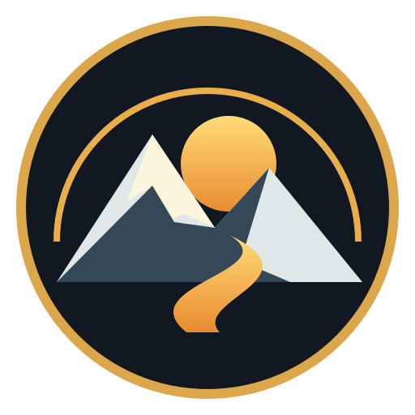

# Daylight GNU/Linux 5

[Documentation en français](README.fr.md)

**A lightweight, reversible desktop layer for Debian and Raspberry Pi OS.**

Founder and developer: **Hamdy Abou El Anein**  
Daylight source license: **GNU GPL version 3 only**  
Project contact: **contact@daylightlinux.ch — activation pending**

Version **5.0.0-rc.1** is a release candidate. The validation report distinguishes implemented features, executed tests and remaining release gates.



## Included components

A separate Fluxbox session, streamlined Conky profiles, branded terminal, optional Fastfetch integration with an ASCII fallback, mountain/sun themes and the original background. A small Rust executable provides local diagnostics, monitoring, secure password generation, utilities and modernized games. Native graphical dialogs use YAD (GTK) only while open. No Electron, persistent control-center daemon or automatic network request when a terminal opens.

| Package | Purpose |
|---|---|
| daylight-core | AMD64 or ARM64 Rust executable, Fastfetch configuration and manual |
| daylight-themes | Backgrounds and icons |
| daylight-desktop | Fluxbox session, Conky, terminal and control center |
| daylight-apps | Utility launchers, speech and notifications |
| daylight-games | Optional offline game launchers |
| daylight-linux | Desktop metapackage |
| daylight-telemetry | Optional boot sender, disabled by default and excluded from the metapackage |

AMD64 and ARM64 builds are provided. ARM 32-bit is not yet supported. The base system remains Debian or Raspberry Pi OS; Daylight does not replace its identity or kernel.

## Installation and use

Use matching architecture packages of the same version. Inspect the checksums and APT's proposed changes. Minimal ARM64 installation:

```sh
sudo apt install ./daylight-core_5.0.0~rc1_arm64.deb ./daylight-themes_5.0.0~rc1_all.deb
daylight status
daylight doctor
```

The full desktop additionally needs the desktop, apps and linux packages. Select **Daylight GNU/Linux** in an existing display manager, or use `startx /usr/bin/daylight-session` from a suitable local console. Daylight itself does not install or restart a display manager.

```sh
daylight info
daylight monitor --watch
daylight control-center
daylight password 24
daylight settings set profile minimal
daylight update --dry-run
sudo daylight update
daylight remove --dry-run
sudo daylight remove
```

Updates require a configured APT repository or newly downloaded local packages. This repository does **not** imply that a public Daylight APT endpoint already exists. Removal targets Daylight packages, never runs autoremove and preserves personal Daylight settings and pre-existing dependencies.

Settings are isolated under `~/.config/daylight` (or XDG_CONFIG_HOME). Existing shell startup files, `~/.fluxbox` and `~/.conkyrc` are not overwritten. `daylight-terminal` uses Terminology when available, otherwise a readable Xterm configuration. Fastfetch is optional; a built-in ASCII display works without it.

## Live edition and privacy

`live/` contains a Debian 13 AMD64 live-image recipe using the same packages. It is not a clone of a personal computer or server. See the validation record before claiming that an ISO has been built or tested. No installation wizard, persistent storage or enabled telemetry is included by default.

Boot statistics are **off by default**, require an optional package and explicit activation. They count received boots, **not unique users**. The payload has no persistent ID. Network endpoints and providers still process the connection's IP; complete transport anonymity is not promised. The reference collector stores daily aggregates and is not automatically deployed.

## Documentation

See `docs/BUILD.md`, `docs/PRIVACY.md`, `docs/PRODUCTION-SAFETY.md`, `docs/LEGACY-AUDIT.md`, `docs/THIRD_PARTY.md` and `docs/VALIDATION.md`.

Historical work is preserved in Git history and archive branches. The new mountain/sun graphics are working designs, not finalized photorealistic artwork. Third-party software retains its original authors and licenses.
