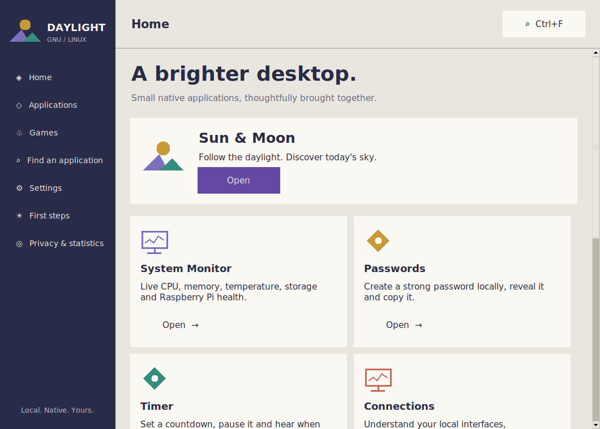
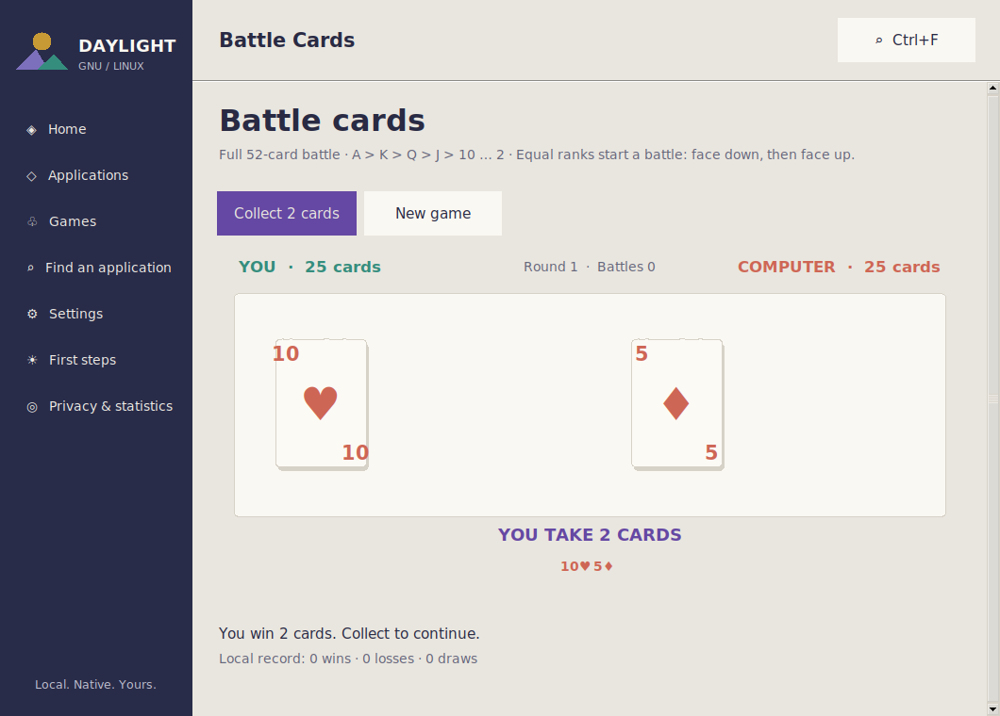
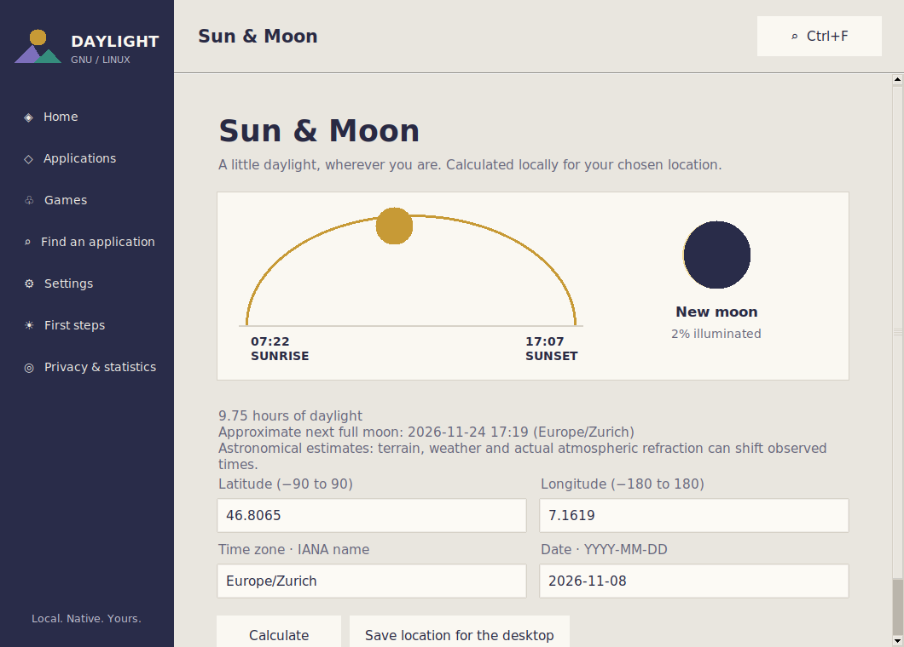

# Daylight desktop refresh — 8 November 2026

Developer: Hamdy Abou El Anein · info@daylightlinux.ch

The `5.0.0~rc4` packages are published in the signed public APT repository.
Run `sudo daylight update` on an existing Daylight installation. This release
starts from `telemetry-production` commit
`017360374eb60773be2c98ccff1c09b65557aac7` and preserves its RC3 telemetry work.
The exact tested package source is `f7d1e02f8eb326cadeb8368ead5cc64d2d2c1050`;
[the release record](../release/rc4-packages.json) contains package hashes,
corresponding source and validation evidence. The published live ISO remains RC2.

## Desktop and applications

The command-line system tools remain Rust. Graphical applications use Python's
standard-library Tkinter and Canvas, following Shardturn's warm ivory, graphite,
Coral, Amber, Jade and Iris palette. Cards, dice and symbols are drawn locally as
vectors. They stay sharp at different sizes and require neither image downloads
nor a web browser. Python 3 and `python3-tk` are supplied through Debian packages;
there is no pip installation step.

The graphical entry point is `/usr/share/daylight/ui/daylight_gui.py`. Its modules
are installed below `/usr/share/daylight/ui/daylight_ui/`. The Rust launcher keeps
`daylight control-center` and `daylight app NAME` as the public interfaces.
Existing command-line invocations remain available on systems without a desktop.

The desktop refresh includes a graphical application library and search,
personalisation, first-run guidance, graphical games, a Raspberry Pi/system
monitor, and Sun and Moon calculations. The settings page uses small PNG
wallpaper previews generated during packaging; Pillow is a build dependency,
not a runtime desktop dependency. User-selected appearance and language settings
belong to the desktop user. Navigation and first steps support English, French
and German; many game and utility texts remain English. Explicit keyboard
choices are remembered for Daylight sessions. Existing games keep local best
scores and win/loss totals in `~/.config/daylight/game-scores.json`; Shardturn
retains its upstream in-memory scoring behavior.

## Shardturn

`daylight-games` contains the exact standalone Shardturn edition from
[`hamdyaea/Shardturn`](https://github.com/hamdyaea/Shardturn), commit
`658a57e7c7e9e1743d99a8c6a59b68c03b8f7963`.

The vendored files live in `desktop/shardturn/`; `SOURCE.json` records their
upstream commit, original license and SHA-256 hashes. The installed entry point
is `/usr/share/daylight/shardturn/Shardturn.py`. Shardturn retains its own name,
icon, developer attribution and **GPL-3.0-or-later** license. The original source
and visual assets are included; they are not relabelled GPL-3.0-only.

Shardturn is available through the Daylight games library and its desktop
launcher. The package also installs `/usr/share/daylight/games.enabled`, allowing
the shell to distinguish a desktop with optional games from a minimal desktop.
Removing `daylight-games` removes this marker and the vendored Shardturn files.

## Package layout

| Package | Role |
| --- | --- |
| `daylight-core` | AMD64 or ARM64 Rust executable and command-line resources |
| `daylight-desktop` | Fluxbox session, Tkinter GUI, search, welcome and settings launchers |
| `daylight-themes` | Existing Daylight photographs, backgrounds and branding |
| `daylight-apps` | Utility launchers, local speech dependencies, monitor, diagnostics, Sun and Moon |
| `daylight-games` | Optional games launchers, Shardturn, original icon and license |
| `daylight-telemetry` | Existing explicitly enabled boot counter |
| `daylight-linux` | Desktop and utility metapackage |

The full installer profile continues to include desktop, applications, games
and the telemetry package. A fresh telemetry installation stays **off** until
`sudo daylight telemetry on`. This desktop refresh does not enable it implicitly.
An already configured opt-in is retained through Debian's existing conffile
handling. The collector and ingress configuration deployed earlier today remain
separate from desktop application packaging.

## Validation and release

The build workflow checks Rust, Python sources, focused game/astronomy/diagnostic
and launcher tests, and the package lifecycle in disposable Debian 12 and 13
containers. The lifecycle test opens the actual installed desktop under Xvfb,
validates desktop launchers, exercises the graphical applications and checks that
removing optional games preserves the desktop. It also checks that fresh
telemetry configuration is disabled and existing user files survive removal.

A complete live ISO build and its BIOS/UEFI/browser checks are selected explicitly
with the workflow's `build_iso` input. Ordinary desktop updates can validate the
packages without rebuilding the ISO. The ISO image published before this refresh
is not claimed to contain the new interface.

Runtime smoke tests and visual review passed before package publication.
Physical Raspberry Pi graphics, audio and power-supply behaviour are not covered
by the virtual-display checks. Power and throttling indicators depend on hardware
support, and Sun and Moon results are estimates rather than precision observatory
ephemerides.

### Completed source validation

The local Rust unit suite passed (28 tests). The CLI integration suite passed
with its intentional root-only desktop preference check skipped. The new graphical
suite opened all application routes at 1060×760 and 800×600 under Tk 8.6/Xvfb,
including real Memory clicks, battle progression, timer cancellation and speech
termination. Separate game, launcher/preferences, solar/lunar and Pi diagnostic
suites passed. The 35 upstream Shardturn tests passed at the pinned revision.
Light/dark screenshots and 800×600 layouts were reviewed. These checks do not
constitute physical Raspberry Pi graphics, audio or power-supply validation.

### Native preview screenshots

Captured from the actual Tk desktop at 1060×760, not design mockups:

The first complete package validation passed on GitHub Actions run
[42474583356](https://github.com/hamdyaea/Daylight-GNU-Linux/actions/runs/42474583356),
including real installation/removal under Debian 12 and 13. A subsequent semantic
colour correction preserves active Battle, Memory and Guess state when automatic
appearance changes; the 20-test game suite includes this regression.

### Updating an existing RC3 installation

The existing `sudo daylight update` command installs RC4 and its Tkinter
dependencies through APT. There is no pip step or second installer. The
upgrade test starts a real RC3 session, runs its old update executable, then
opens an RC4 application through the normal `daylight app` command. It checks
user settings and opted-in telemetry remain unchanged, and that the first
ordinary UI opening hands the existing session to one new appearance manager
without replacing Fluxbox or asking for a logout. Only verified same-user,
same-display Daylight Conky/background processes are handed over; other
desktops, Waybar and Raspberry Pi Connect are outside that operation.

The existing Raspberry Pi Wayland integration is supported without overwriting
its separately owned session-defaults files. Its Lua Conky wrapper receives
the separate generated main profile, and the manager owns its swaybg child.
Installations keep their chosen optional profile: a core-only installation
does not unexpectedly acquire the desktop or games.

### Published package validation

The final source passed [push run 42476944191](https://github.com/hamdyaea/Daylight-GNU-Linux/actions/runs/42476944191):
Rust and application tests, AMD64/ARM64 package builds, fresh installation/removal
on Debian 12 and 13, and live RC3-to-RC4 upgrades using only the old update command.
Both upgrade checks retained Fluxbox, user files and an existing telemetry opt-in.
Public HTTPS downloads were checked against the pinned archive key and all eight
CI package hashes for both architectures. Exact corresponding source and the
validation ZIP are available from the release record.

The production Raspberry Pi was then upgraded from its installed RC3 packages
using `daylight update`. All seven installed Daylight packages reached RC4; ten
non-root CLI tests and installed Tk/GUI/Shardturn imports passed on ARM64. The
telemetry-default test was excluded because this machine was already opted in;
no artificial boot event was sent. Thirteen checked configuration files, seven
tracked services and all Docker containers retained their previous state.
